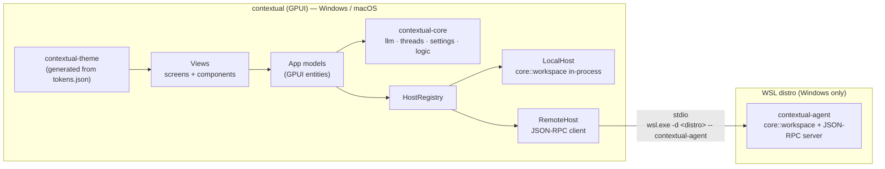

# Native Rust port (GPUI)

| | |
| --- | --- |
| **Status** | In progress — Phases 2–5 built (app runs in WSL); Phase 1 gate pending Windows/macOS runs; Phase 6 started |
| **Owner** | Tobias Legenden |
| **Date** | 2026-11-06 |
| **Scope** | Replace the whole app — React UI (`src/web/`) and the Node "backend" mounted inside Vite (`src/server/`) — with a native Rust desktop app built on **GPUI**, for **Windows and macOS**. The Windows app can also open projects that live inside WSL. |
| **Supersedes** | The earlier Tauri + React plan (kept as the fallback in Appendix A). |

## 1. Summary

Contextual today only runs as long as `vite` runs: the `/api` routes are a Vite plugin
(`src/server/plugin.ts`), so the app is tied to a dev server, reloads itself when it saves into
its own repo, and is guarded against other websites by a same-origin check instead of by
construction.

We will build a **native Rust application** with no webview, no JavaScript and no HTTP server:

1. **`contextual-core`** — a headless Rust library holding all logic: today's server
   (files, scan, apply/undo, git, PRs, threads, Foundry) **and** today's pure UI logic in
   `src/web/lib/` (diff, markdown/response parsing, edit blocks, prompt building, selection and
   token sums).
2. **`contextual` app** — a GPUI application (with `gpui-component` for standard widgets) that
   renders the Contextual design system natively on Windows (DirectX) and macOS (Metal).
3. **`WorkspaceHost`** — every project-file operation goes through one interface with two
   implementations: *Local* (in-process) and *Remote* (JSON-RPC over stdio to a small
   `contextual-agent`). On Windows, the Remote host runs the agent inside WSL, the same model VS
   Code's Remote-WSL uses.

**Targets:** desktop app for **Windows and macOS only**. Linux code exists only as the headless
`contextual-agent`, deployed by the Windows app into a WSL distro.

**Migration style:** a UI rewrite can't be swapped in route by route, so the new app is built
**alongside** the current one. The current Node/React app stays usable (inside WSL, as today)
until the native app reaches feature parity, including WSL projects. Then it is removed.

**First milestone is a go/no-go spike** (Phase 1). GPUI is pre-1.0; if it fails the gate
criteria, we fall back to Appendix A without having lost work, because `contextual-core` is UI
independent.

## 2. Context

- **UI:** React 19 + TypeScript + Vite 8 + Tailwind v4, ~8,300 lines:

  | Area | Lines | Notes |
  | --- | --- | --- |
  | `lib/` | 1,645 | Pure logic: syntax tokenizer, LCS diff + word ranges, response parser, `changes`, `edits`, `prompt`, `images`, `tree`. Moves to `contextual-core`. |
  | `state/` | 1,395 | `AppProvider`: all UI state. Becomes app models. |
  | `components/` | ~4,450 | `ui/` primitives (662), chat (1,026), scm (512), pr (469), explorer, code, diff, changes, apply, project, shell. Rewritten as GPUI views. |
  | `screens/` | 659 | Welcome, Workspace, Diff, Settings. |
  | `styles/tokens.css` | 231 | Mirror of `tokens.json`. Replaced by a generated Rust theme. |

- **Server:** ~2,300 lines across 12 files (`src/server/README.md` is the behaviour reference):
  config + health, Foundry chat (Responses API with `previous_response_id`, fallback to chat
  completions, chain reset), edit repair, folder browsing, project scan (exclusions,
  `.gitignore`, token estimates, skill discovery, HTML/SVG condensing), file read, apply/undo
  with line-ending/BOM preservation and optimistic checks, saved threads, git (status, stage,
  diff, commit, push, branches) and PRs via `gh`.
- **Design system:** `docs/design/contextual/` — `README.md`, `tokens.json` (dark + light
  themes; Inter for UI, JetBrains Mono for code, loaded from Google Fonts today), and one spec
  per component/screen (ApplyDialog, ChangesPanel, ChatMessage, CodeBlock, CodeView, Composer,
  ContextBar, Controls, DiffFile, FileTree, RulesPanel, Toast, Screen*). These stay the UI spec.
- **Platform assumptions baked in today:** the server assumes it runs inside WSL/Linux/macOS
  (`fs/paths.ts` translates `C:\…` → `/mnt/c/…`; `fs/browse.ts` lists `/mnt/<x>`; caches under
  `~/.cache`).
- **Client state:** settings and recents in `localStorage`, open folder in `sessionStorage`,
  `#open=<path>` deep link; secrets in `.env.local`.
- **Tests:** none today. This is the biggest risk for a rewrite; see §11.

## 3. Goals

- G1. Native desktop app on **Windows 10/11 and macOS (Apple Silicon + Intel)**, written in
  Rust, with no webview, no JavaScript runtime and no network listener.
- G2. Open projects that live **inside WSL from the Windows app**, with native-speed file and git
  access and the user's WSL git config and `gh` login. Local Windows projects (`C:\…`) are
  handled natively, not through WSL.
- G3. **No standalone backend service**: helper processes (the WSL agent, git, gh) are started on
  demand and owned by the app; nothing keeps running after it closes.
- G4. **Feature parity** with the current app: every route in `src/server/README.md` and every
  screen in `docs/design/contextual/components/`.
- G5. **Design-system fidelity**: `tokens.json` stays the only source of colours, spacing, radii,
  shadows and type styles; both themes; the component specs are followed.
- G6. Keep the safety model: the model never writes to disk; saving is explicit, checked against
  what the model saw, atomic and undoable.
- G7. Feel native and fast: large trees, files and diffs stay smooth (virtualised rendering).

## 4. Non-goals

- Shipping a Linux desktop build. (The app does build and run on Linux: that is the development
  loop, shown through WSLg. It is not a supported target.)
- Keeping React/TypeScript in any form (no Tauri, no Dioxus/Leptos webview).
- Remote hosts other than WSL (SSH, dev containers). The design must *allow* them.
- Auto-update, code signing / notarization and installers for distribution. Unsigned local builds
  are fine for a local-only tool. Revisit if it is shared.
- Replacing the `git` / `gh` CLIs with `git2` or `gix`. Shelling out keeps behaviour identical to
  the terminal and reuses the user's credentials.
- An in-app code *editor*. Code views stay read-only, as today.

## 5. Decision and alternatives

**Decision:** native GPUI app + `gpui-component`, a UI-independent Rust core, and a stdio agent
for WSL.

| Option | Verdict | Why |
| --- | --- | --- |
| **GPUI + gpui-component** | ✅ Chosen | Built for exactly this kind of app: Zed (which GPUI was made for) renders code views, diffs, markdown, git panels and very large files with it, on Windows and macOS. GPU-rendered, fast text, virtualised lists. `gpui-component` provides tree, virtual list, inputs, select, dialog, popover, markdown and tree-sitter highlighting. Pre-1.0: API churn and thin docs. |
| Iced | ⚠️ Backup native option | More stable API, text editor and markdown widgets; code views and diffs need more custom work, and matching the design system is harder. |
| Slint | ❌ | Good for forms; weak at rich text, code views and diffs. |
| egui | ❌ | Fastest to start, but immediate-mode styling makes the design system hard to match. |
| Dioxus desktop / Leptos in Tauri | ❌ | All Rust, keeps CSS, but still a webview — not the native app wanted. |
| Tauri v2 + React | ⚠️ Fallback (Appendix A) | Least work; Rust backend only. Used if GPUI fails the Phase 1 gate. |

## 6. Architecture



### 6.1 Repository layout

```
Cargo.toml                 # workspace; default-members excludes crates/app on Linux
crates/
  core/                    # contextual-core: no GPUI, no transport
    src/workspace/         # paths, browse, scan, condense, read, apply, undo, git, pr
    src/llm/               # config, Foundry (Responses + chat completions), repair, drafts
    src/logic/             # ported from src/web/lib: diff, response parser, changes, edits,
                           #   prompt (incl. FILE_FORMAT), tree sums, image scaling + token estimate
    src/threads.rs
    src/settings.rs
    src/process.rs         # CommandRunner (PATH, no console window, timeouts)
    src/platform.rs        # dirs, hidden-file rules, drive/volume listing
  protocol/                # serde types for app <-> agent
  agent/                   # contextual-agent (Linux only): stdio JSON-RPC loop around core::workspace
  theme/                   # contextual-theme: build.rs turns docs/design/contextual/tokens.json
                           #   into typed Rust (colours, spacing, radii, shadows, type styles)
  app/                     # contextual: the GPUI app (Windows, macOS)
    src/models/            # AppState, Project, Thread, Changes, Scm, Settings
    src/views/             # one module per design spec: file_tree, code_view, diff_file,
                           #   chat_message, composer, changes_panel, apply_dialog, …
    src/screens/           # welcome, workspace, diff, settings
    src/ui/                # primitives: button, checkbox, switch, segmented, tag, icon, kbd, …
    assets/                # bundled fonts (Inter, JetBrains Mono — OFL), icons (SVG)
docs/design/contextual/    # unchanged: the UI spec
src/, package.json, …      # the current app; deleted at cutover (Phase 7)
```

### 6.2 Where each concern runs

**Anything that touches project files or project tools runs on the host where the project
lives; anything else stays in the app.**

| Concern | Runs in | Notes |
| --- | --- | --- |
| Browse, scan, read, condense | Workspace host | |
| Apply, undo, undo snapshots | Workspace host | Snapshots in that host's cache dir. |
| git, branches, PR (`gh`) | Workspace host | That host's git config and `gh` auth. |
| Foundry calls (chat, test, repair) | App | Needs network + key, not files. |
| Commit message / PR drafts | App, orchestrating | Asks the host for diff/commits, then calls the model. |
| Response parsing, diffs, prompt building | App (`core::logic`) | Pure functions. |
| Threads, settings, API key | App | Settings file in config dir; key in OS keychain. |

### 6.3 Core interfaces (sketch)

```rust
/// Where a project lives. `Wsl` exists only in Windows builds.
pub enum Location { Local, Wsl { distro: String } }

#[async_trait]
pub trait WorkspaceHost: Send + Sync {
    async fn list_dirs(&self, req: ListDirs) -> Result<DirListing>;
    async fn scan(&self, req: Scan) -> Result<ScanResult>;
    async fn read(&self, req: ReadFiles) -> Result<Vec<FileContent>>;
    async fn apply(&self, req: Apply) -> Result<ApplyResult>;
    async fn undo(&self, req: Undo) -> Result<()>;
    async fn git(&self, req: GitRequest) -> Result<GitResponse>;   // status, stage, diff, commit, push, branches…
    async fn pr(&self, req: PrRequest) -> Result<PrResponse>;      // compare, create
}
```

- `LocalHost` calls `core::workspace` directly; `RemoteHost` serialises the same `protocol`
  types over JSON-RPC. Both pass the same test suite (§11).
- Errors: a typed enum (`thiserror`) with a stable code + human message, shown in the UI the
  way the design spec describes (Banner / Toast).

### 6.4 App structure (GPUI)

- **Models are GPUI entities.** `AppState` (open project, location, screen, settings) owns
  `Project` (tree, selection, token sums), `Thread` (messages, streaming state, `fileVersions`,
  `previous_response_id`), `Changes` (proposed files, accept/reject, save/undo), `Scm`. Views
  observe models and re-render on `cx.notify()`. This replaces `AppProvider` + `useApp()`.
- **Business rules stay in `core`.** Models call core functions and hold results; they don't
  reimplement logic. This keeps the app thin and testable without a window.
- **Async runtime.** `reqwest` needs a tokio reactor, GPUI has its own executor. The app owns
  one tokio runtime on background threads; core futures are spawned there and their
  `JoinHandle`s awaited from `cx.spawn`. Streaming chat sends `ChatEvent`s over a channel that a
  GPUI task drains into the `Thread` model.
- **Cancellation:** every long operation gets a `CancellationToken`; closing a thread or pressing
  Stop cancels it, and dropping the stream aborts the HTTP request.
- **Virtualisation everywhere it can grow:** file tree, code view, diff view and chat history use
  `uniform_list`/virtual lists. The design spec's collapsed unchanged regions in diffs are list
  rows, not hidden DOM.
- **Text:** code views, diffs and code blocks use tree-sitter highlighting (via
  `gpui-component`'s highlighter, or `tree-sitter-highlight` directly) mapped to the `syn-*`
  tokens. Chat prose renders markdown natively, incrementally as deltas arrive.
- **Input:** composer is a multi-line input with IME support; pasted and dropped images go
  through `core::logic::images` (2048px scaling, vision token estimate). File drops use GPUI's
  external-paths events.
- **Keyboard:** all actions are GPUI `actions!` with keybindings in one keymap (per-OS: `cmd`
  on macOS, `ctrl` on Windows), matching the shortcuts the current app has.
- **Windows and dialogs:** native folder picker (`cx.prompt_for_paths`) for local projects; the
  custom folder browser stays for WSL. Apply, PR and branch picker are in-window dialogs/popovers
  as in the design specs.

### 6.5 Design system in Rust

- `crates/theme/build.rs` reads `docs/design/contextual/tokens.json` and generates
  `Theme { dark, light }` with typed fields (`color.surface_100`, `color.ink_muted`,
  `color.diff_add_word`, `color.syn_keyword`, `space(2)`, `radius.md`, `shadow.popover`,
  `type_style.ui_body`, …). Changing `tokens.json` changes the app on the next build; there is no
  hand-written mirror any more.
- Views only use theme fields. A clippy-style check (simple grep in CI) rejects literal
  `rgb(…)`/`hsla(…)`/pixel values in `crates/app` outside `theme`.
- `gpui-component`'s own theme is configured from the same generated values so its widgets match.
- Spacing uses only the token steps (1, 2, 3, 4, 6, 8 × 4px); fixed layout widths from the
  README (312px, 320px, 820px) become named constants.
- **Fonts are bundled** (Inter, JetBrains Mono; both SIL OFL) instead of Google Fonts; code
  ligatures off, tab width 4, as the README requires. Fallbacks: Segoe UI / Cascadia Code /
  Consolas on Windows, system fonts on macOS.
- Dark is the default theme; light is selectable; optionally follow the OS appearance.

### 6.6 App ↔ agent protocol (WSL)

- **JSON-RPC 2.0**, newline-delimited over the agent's stdin/stdout; stderr carries `tracing`
  logs, which the app forwards to its log.
- **Handshake:** first call is `initialize { protocolVersion, appVersion }` →
  `{ agentVersion, capabilities }`. Mismatch → the app redeploys the matching agent.
- **Cancellation:** `$/cancel { id }` notification. **Progress** (long scans): notifications.
- **Deployment:** the Windows build bundles a static Linux agent (`x86_64-unknown-linux-musl`,
  plus `aarch64` if needed). On first connect to a distro the app copies it to
  `~/.cache/contextual/agent/<version>/contextual-agent` in that distro (via
  `wsl.exe -d <distro> -- sh -c 'mkdir -p … && cat > … && chmod +x …'` fed from stdin), then
  launches it. Old versions are pruned.
- **Lifecycle:** one agent per distro, started lazily, restarted with backoff if it dies, killed
  when the app exits (job object on Windows so it can't outlive the app).
- **Distro discovery:** read the registry, not `wsl.exe` output. Installed distros are the
  subkeys of `HKCU\Software\Microsoft\Windows\CurrentVersion\Lxss` (`DistributionName`), and
  `DefaultDistribution` holds the default one's GUID. This needs no process and has no
  encoding issues.
  - **Fallback:** `wsl.exe --list --quiet`. Its output encoding is **not fixed**: UTF-16LE by
    default, UTF-8 when `WSL_UTF8=1`, and UTF-8 was observed on the development machine with
    `WSL_UTF8` unset. Detect it per call (UTF-16LE if the bytes contain NULs or start with
    `FF FE`, otherwise UTF-8) and cover both cases with tests.
  - Treat other `wsl.exe` output (errors, `--status`) the same way.
- **Location detection (Windows app):** replaces today's path translation in `fs/paths.ts`.
  - `C:\src\x` → `Location::Local` + `C:\src\x` (opened natively, not through WSL).
  - `\\wsl.localhost\Ubuntu\home\me\x` or `\\wsl$\Ubuntu\…` → `Location::Wsl { distro: "Ubuntu" }`
    + `/home/me/x`.
  - A POSIX path such as `/home/me/x` or `~/x` → the default WSL distro, when WSL is installed.
  - `/mnt/c/src/x` → `Location::Local` + `C:\src\x`, since native access is faster.
- **macOS** only accepts native paths (`/Users/…`, `~`); the Windows/WSL translations are
  compiled out.

## 7. Platform matrix

| Concern | Windows app | macOS app | WSL agent (Linux, headless) |
| --- | --- | --- | --- |
| Rendering | GPUI DirectX renderer; check behaviour over RDP / without a GPU (WARP) | GPUI Metal renderer | None |
| Paths | `PathBuf` + `dunce::canonicalize` (avoid `\\?\` prefixes); long paths | Case-insensitive APFS by default | Case-sensitive |
| Containment check (`resolveInside[Real]`) | Canonicalised, case-insensitive | Canonicalised, case-insensitive | As today |
| Hidden files | `FILE_ATTRIBUTE_HIDDEN` **or** leading `.` | Leading `.` (+ `UF_HIDDEN` optional) | Leading `.` |
| Spawning git/gh | `CREATE_NO_WINDOW` (also for `wsl.exe`); resolve `git.exe`/`gh.exe` | **GUI apps don't inherit the shell `PATH`** — resolve once via `$SHELL -ilc 'printf %s "$PATH"'`, fall back to `/opt/homebrew/bin:/usr/local/bin` | Started via `wsl.exe` (non-interactive env) — resolve `PATH` from the login shell like macOS |
| Git env | `GIT_TERMINAL_PROMPT=0`, `GCM_INTERACTIVE=never` | `GIT_TERMINAL_PROMPT=0` | `GIT_TERMINAL_PROMPT=0` |
| Writing files | Temp file + atomic replace, retry on sharing violations (editors/AV hold files) | Temp + rename | Temp + rename |
| Folder picker | Native dialog for local; custom browser for WSL | Native dialog | Serves the custom browser's listings |
| "Places" in browser | Home, drives (`GetLogicalDrives`), one entry per WSL distro | Home, `/Volumes/*` | Home and `/` of that distro (`/mnt/<x>` hidden: opened locally) |
| Shortcuts | `ctrl` | `cmd`; standard app menu (About, Settings…, Quit) | — |
| Data dirs (`directories` crate) | `%APPDATA%`, `%LOCALAPPDATA%` | `~/Library/Application Support`, `~/Library/Caches` | XDG (agent binary, undo snapshots) |
| API key | Credential Manager (`keyring`) | Keychain | Never sent to the agent |
| Build | `windows-latest`; bundles the musl agent built on `ubuntu-latest` | `macos-latest`, universal binary, ad-hoc signed | `ubuntu-latest`, static musl, x86_64 (+ aarch64) |

Line endings, BOM and final-newline preservation on save must behave identically on every
target (byte-level logic, so a test requirement, not a platform branch).

## 8. Development environment

All development happens on Linux (WSL, Ubuntu); no Windows toolchain is needed.

- **Build, test and run in WSL.** Every crate, including the GPUI app, builds natively; the app
  window opens through WSLg. One-time setup:
  `sudo apt-get install -y libxkbcommon-x11-dev libwayland-dev libx11-xcb-dev libfontconfig-dev libfreetype-dev libvulkan-dev libasound2-dev clang mingw-w64`,
  plus `rustup target add x86_64-unknown-linux-musl x86_64-pc-windows-gnu`.
- **Windows `.exe` from Linux:** `cargo build -p contextual --target x86_64-pc-windows-gnu`
  (mingw-w64) for quick checks on Windows. Debug builds compile the DirectX shaders at runtime;
  release builds precompile them with `fxc.exe`, so release `.exe`s come from CI
  (`windows-latest`). A Windows PC with Smart App Control on blocks unsigned local builds;
  test on a machine without it, or sign release builds later.
- **macOS:** CI (`macos-latest`) builds and tests every change; manual testing on a friend's Mac
  at the Phase 1 gate and before cutover.
- **The current app** keeps running inside WSL with `npm run dev` throughout, for daily use and
  for side-by-side comparison.

## 9. Data, configuration and security

### 9.1 Storage and migration

| Data | Today | After | Migration |
| --- | --- | --- | --- |
| Foundry config | `.env.local` in the repo | `settings.json` in the config dir; edited in Settings | On first run, offer to import from a `.env.local` path. Env vars still override (useful for dev). |
| API key | `.env.local` | OS keychain | Imported with the config; never written to `settings.json`. |
| UI settings, recents | `localStorage` | `settings.json` / `state.json` in the config dir | Not readable from a native app; add an "Export settings" button to the current app before cutover, import once. |
| Threads | `~/.cache/contextual/threads/` (inside WSL) | App **data** dir (chats aren't a cache) | The Windows app offers to import from `\\wsl.localhost\<distro>\home\<user>\.cache\contextual\threads`, re-keying WSL projects to `Location::Wsl` and `/mnt/<x>` projects to local Windows paths; the original is left in place. |
| Undo snapshots | `~/.cache/contextual/undo/` | Cache dir on the workspace host | None needed (short-lived). |
| Open folder on reload | `sessionStorage` | Last open project restored on start | — |
| `#open=<path>` | URL hash | CLI argument (`contextual <path>`) and `contextual://open?path=` deep link | — |

### 9.2 Security model

- **No network listener and no webview.** The same-origin/`Content-Type` checks disappear, and
  there is no HTML/JS surface for model output to inject into: markdown is parsed and drawn
  natively, never interpreted as HTML.
- **Links in model output** open in the OS browser only after a click, and only for
  `http(s)` URLs.
- **The API key** lives in the OS keychain, is read only by `core::llm`, and is never logged or
  sent to the agent.
- **Path containment** stays in the core (`resolve_inside`, symlink-aware variant) and is
  enforced on the workspace host, so the agent is as safe as the local host.
- **Root allowlist:** workspace operations accept only roots the user opened (dialog, recents,
  CLI).
- **Process execution:** fixed argument vectors, never a shell; inherited env filtered.
- **Endpoint validation** (HTTPS, or `http://localhost` for mocks) is ported as-is.

## 10. Delivery plan

Each phase has exit criteria. Phases 1 and 2 can run in parallel (UI spike on Windows, core in
WSL). The current app stays in use until Phase 7.

### Phase 0 — Capture current behaviour

- **Server parity fixtures:** representative projects (CRLF/BOM files, `.gitignore`, skills,
  large HTML/SVG, images, symlinks) and the JSON each route returns for them, recorded from the
  current Node server.
- **Logic fixtures:** inputs/outputs for `lib/` functions (diff hunks and word ranges, response
  parsing, edit-block placement and failures, prompt assembly, token sums).
- **UI reference:** screenshots of every screen and dialog in both themes, plus a feature
  checklist per screen (states, shortcuts, empty/error states) derived from the current app and
  the design specs. This is the parity checklist for Phases 3–5.
- **Exit:** fixtures and checklist checked in.

### Phase 1 — GPUI spike and go/no-go gate

- Workspace skeleton; `crates/theme` generated from `tokens.json`; bundled fonts.
- Pin a **matched pair** of `gpui` and `gpui-component` (same source: crates.io release or a
  pinned git revision, whichever `gpui-component` targets) with a committed `Cargo.lock`. The
  crates.io `gpui` has lagged behind Zed's repository, so this choice is made here and recorded.
- Prototype, in both themes, on Windows and macOS:
  1. A file tree of 20,000 rows with checkboxes and token sums (virtualised).
  2. A read-only code view of a 5,000-line file with tree-sitter highlighting in the `syn-*`
     colours.
  3. A side-by-side diff with word-level highlights and collapsed unchanged regions.
  4. A composer: multi-line input, IME, image paste and file drop.
  5. Streaming markdown of a ~50 KB reply with code blocks, appended live.
  6. A dropdown, a modal dialog and a toast styled from the tokens.
- CI: `cargo fmt --check`, `cargo clippy -D warnings`, `cargo test` on all jobs; app build on
  `windows-latest` and `macos-latest`; core tests on `ubuntu-latest`.
- **Gate (all must pass):** smooth scrolling in 1–3; correct text rendering and IME on both OSes;
  visuals match the design spec within reason; build works from a clean checkout on Windows and
  macOS; no blocking bug in the pinned GPUI. **If it fails:** switch to Appendix A; Phases 0 and
  2 carry over unchanged.

### Phase 2 — Core (headless, in WSL)

- Port `src/server/` to `core::workspace`, `core::llm`, `core::threads`, `core::settings`
  (scan with `ignore` + `globset`, HTTP with `reqwest` (rustls) + an SSE parser, no OpenAI SDK).
- Port `src/web/lib/` to `core::logic`.
- `LocalHost` + root allowlist.
- **Exit:** all Phase 0 server and logic fixtures pass; core tests green on Linux, Windows and
  macOS CI.

### Phase 3 — App shell and read-only flows

- Welcome (recents, open folder), Workspace layout (explorer, rules panel, context bar, status
  bar), code preview, Settings (Foundry config + keychain, connection test, theme), app menu and
  keymap, CLI argument.
- **Exit:** open a local project on Windows and macOS, browse, select files and see token sums
  and rules, configure and test the connection — matching the Phase 0 checklist for these
  screens.

### Phase 4 — Chat, changes and saving

- Composer (text, images), streaming replies (Responses API, chain reset, fallback), chat
  messages with markdown and code blocks, context bar usage/cost, saved threads (Chats panel:
  search, rename, delete, delete all).
- Changes panel from `### FILE:` / `### EDIT:` / `### DELETE:` blocks, quiet re-request of
  unplaceable edits (repair), Diff screens (unified + split), Apply ("Save") dialog, save with
  pre-checks, Undo, toasts.
- **Exit:** a full chat → review → save → undo cycle on a local project, matching the checklist.

### Phase 5 — Source Control and pull requests

- Source Control tab (stage, unstage, diff, commit, smart commit, push, model-drafted commit
  message), branch picker (switch, create with recorded parent), PR compare view (base/compare
  dropdowns, commits, file diffs, drafted title/body, create via `gh`).
- **Exit:** all Source Control and PR checklist items pass on Windows and macOS.

### Phase 6 — WSL remote host (Windows app)

- `contextual-agent`, musl builds, bundling, deployment and lifecycle; `RemoteHost`; distro
  discovery; location detection.
- UI (Windows only): location badge in the status bar (*Local* / *WSL: Ubuntu*), WSL distros
  under "Places", threads keyed by location.
- **Exit:** from the Windows app, open a project in `\\wsl.localhost\Ubuntu\…` and complete scan,
  chat, save, undo, commit and PR, with timings comparable to today's app running inside WSL.
  The host test suite passes against `RemoteHost`.

### Phase 7 — Cutover

- Data migration (§9.1), deep link, app icons, release builds for Windows and macOS.
- Delete `src/`, `index.html`, `package.json`, Vite/Tailwind/oxlint config and `components.json`;
  remove the JS-only project skills (`shadcn`, `tailwind-design-system`,
  `vercel-composition-patterns`, `vercel-react-best-practices`) from `.claude/skills/`.
- Rewrite `CLAUDE.md` for the Rust workspace (layout, theme rule, build commands, platform
  notes); replace `src/server/README.md` with a `crates/core` reference.
- **Exit:** the native app is the only app; you've used it as your daily tool for a week on
  Windows (local + WSL projects) and it was smoke-tested on the Mac.

### Phase 8 — Hardening

- Performance pass on large repos (including skill discovery's 20,000-entry cap), locally and
  over the agent.
- Failure drills: agent crash mid-save, distro shut down, WSL not installed, `gh` logged out,
  git missing, keychain unavailable, file locked on Windows, no GPU / RDP.
- Accessibility pass (§12, risk on screen readers).

## 11. Testing strategy

1. **Unit tests in `core`**: path normalisation and containment (Windows and case-insensitive
   cases), exclusion rules, token estimates, condensing, line-ending/BOM/final-newline
   preservation, apply pre-checks, and all of `core::logic`.
2. **Parity tests** replay the Phase 0 fixtures against the Rust core, field by field, with
   documented allowances (e.g. `mtimeMs`). They define "done" for Phase 2.
3. **Host contract suite**: one generic suite run against `LocalHost` and `RemoteHost` (agent
   spawned locally on Linux CI), so the two can't drift.
4. **Git integration tests** in temporary repos; `gh` is behind `CommandRunner` and faked.
5. **LLM tests** against a local mock server (`wiremock`): streaming, usage, chain reset,
   fallback, cancellation, error mapping, using recorded real responses with the key redacted.
6. **Model tests without a window**: app models are driven through GPUI's test context
   (`TestAppContext`) for flows like send → stream → parse changes → save → undo.
7. **Visual checks**: the Phase 0 screenshot set is compared by eye at each phase exit;
   automated screenshot diffs are optional later.
8. **Manual smoke checklist** per phase exit on Windows and macOS, plus WSL projects from Phase 6.

## 12. Risks and mitigations

| Risk | Impact | Mitigation |
| --- | --- | --- |
| GPUI is pre-1.0: API churn, thin docs, crates.io release lagging Zed's repo | High | Phase 1 gate; pin a matched `gpui`/`gpui-component` pair with a committed `Cargo.lock`; upgrade deliberately, not continuously; keep app code thin over core. |
| Long time before the new app is usable (full UI rewrite) | High | Current app stays in daily use until Phase 7; phases deliver usable slices (read-only → chat → SCM → WSL). |
| Behaviour drift (no existing tests) | High | Phase 0 fixtures and checklist; parity tests gate Phase 2; screen checklists gate Phases 3–5. |
| A design-spec detail is hard in GPUI (custom widgets, text layout) | Medium | Spike the hardest components first (Phase 1); accept documented, small visual deviations. |
| Screen-reader support in GPUI is limited | Medium | Decide the requirement (open question 1); keyboard navigation and focus order are covered regardless. |
| Windows rendering over RDP / without a GPU | Medium | Test in Phase 1 and Phase 8; document requirements. |
| Agent deployment fails (no space, noexec, arm64 distro) | Medium | Deploy to `~/.cache`; static musl builds for x86_64 and aarch64; clear error with a manual install command. |
| macOS GUI `PATH` misses Homebrew git/gh | Medium | PATH resolution in `CommandRunner`; "git/gh not found" diagnostic in Settings. |
| Windows file locks break atomic save | Medium | Retry with backoff; pre-checks before any write, so a partial save is impossible. |
| No Mac for day-to-day development | Low | `macos-latest` CI on every change; manual tests on a friend's Mac at the Phase 1 gate and before cutover. |

## 13. Open questions

1. Is screen-reader support a requirement, or are keyboard navigation and focus enough?
2. Should a POSIX path typed into the Windows app (`/home/me/x`) open in the default WSL distro,
   or should the user always pick the distro?
3. Which WSL distros/architectures must the agent support at first?
4. Follow the OS light/dark setting, or keep dark as the fixed default with a manual switch?
5. Do we want a `contextual` CLI shim on `PATH` (like `code .`)?

## 14. Decision log

| Date | Decision |
| --- | --- |
| 2026-11-06 | Port the server to Rust inside Tauri v2; keep the React UI. *(Superseded the same day.)* |
| 2026-11-06 | WSL projects are served by a stdio agent inside the distro, not via `\\wsl.localhost` file access. |
| 2026-11-06 | Keep shelling out to `git` and `gh`; no libgit2/gix. |
| 2026-11-06 | Desktop targets are Windows and macOS only; no Linux desktop build. WSL projects are a Windows-app feature. |
| 2026-11-06 | **Build a native GPUI app instead of Tauri + React.** Tauri remains the fallback if the Phase 1 gate fails. |
| 2026-11-06 | Develop entirely on Linux: the GPUI app runs in WSL through WSLg; Windows `.exe`s are cross-compiled (mingw) for checks, and release builds come from CI. No Windows toolchain on the dev machine. |
| 2026-11-06 | GPUI pinned through `gpui-kit = "=0.9.0"` (crates.io), which pins `gpui-pre =0.3.11` and the matching `gpui-component`. |
| 2026-11-06 | `tokens.json` stays the only design source; the Rust theme is generated from it at build time. |
| 2026-11-06 | The current app stays in use until the native app reaches parity, including WSL projects. |
| 2026-11-06 | `core::llm` and `settings` sit behind the default `llm` feature. The agent builds without it: no HTTP/TLS stack (pure-Rust static musl binary), and Windows/macOS type-checks run from WSL without a C cross-compiler. |
| 2026-11-06 | Git and PR operations travel as one `workspace/git` method with a tagged `GitCall`/`GitReply`; typed helpers live on `dyn WorkspaceHost`. Stage/unstage reply with the new status, as the old routes did. |
| 2026-11-06 | Allowed roots are sent in the agent's `initialize`; opening another WSL project reconnects. |

## 15. Progress

| Phase | State |
| --- | --- |
| 0 — Capture behaviour | Logic, fs, git and LLM fixtures recorded from the TS code by scripts under `crates/core/tests/fixtures/` (re-runnable with Node 24). UI screenshots and per-screen checklist: not done. |
| 1 — GPUI spike | Spike built (`crates/app`, run with `cargo run -p contextual`; `CONTEXTUAL_SPIKE=tree\|code\|diff\|composer\|stream\|controls`, `CONTEXTUAL_THEME=light`). All six prototypes render from the tokens in both themes in WSL (WSLg, software Vulkan); bundled fonts, ligatures off. Windows `.exe` cross-compiles (mingw). **Gate still open:** smoothness on real GPU, IME and text on Windows and macOS, clean-checkout builds there (CI `app-release` job). Known gaps: no emoji font in WSL; long diff lines are clipped (no horizontal scroll yet). |
| 2 — Core | Done: `core::logic`, `core::workspace` (paths, browse, scan, condense, read, apply/undo, git, PR), `core::llm`, `threads`, `settings`, `process`, `WorkspaceHost` + `LocalHost` + root allowlist. Parity tests pass on Linux; core type-checks (clippy) for Windows and macOS. Windows/macOS CI not run yet. |
| 3 — App shell | Built: Welcome (recents, Open folder dialog over the host's `list_dirs`), Workspace (sidebar with Files / Rules tabs, virtualised explorer with filter, Select all / Clear, Respect .gitignore; Skills & Rules with previews; preview tabs with tree-sitter code view, Copy, Wrap lines, image previews; context bar from `core::logic::context`), Settings (Foundry fields, API key in the OS keychain with a session-only fallback, Test connection, exclusions, output prompt, Dark / Light / System), status bar, keymap (Open, Settings, Theme, Quit, Close folder), `contextual [PATH]`, last project reopened on start. Settings in `settings.json`, recents in `state.json`. Model and helper tests pass; Welcome, Workspace and Settings checked by eye in WSLg (dark). Interactions (clicking, previews, saving settings, the folder dialog) not yet tried by hand. Launch flags `--no-restore`, `--settings`. |
| 4 — Chat, changes, saving | Built and run end to end against a local mock of the Responses API: composer (Ctrl+Enter, Stop, picture paste/drop, Resend full context / Only send new message), streaming replies rendered natively from `core::logic::markdown` (code blocks highlighted in `syn-*`, EDIT blocks shown as rebuilt files), usage and cost per reply, notes (stopped, chain reset, chat-completions fallback, cut off), Changes panel, quiet repair of unplaceable edits, Diff screen (unified / split with wrapping, word highlights, expandable gaps, Copy file / Copy diff, Include in save), Save dialog, Undo toast, saved chats (Chats menu: search, open, rename, delete, delete all; old saved-thread JSON reads as-is). Checked by eye: chat, unified and split diff, saved toast, undo, Chats. Save and undo verified on disk with `git status`. Pure turn logic in `core::chat` (tested). Not yet tried against real Azure; links in replies are shown but not clickable yet. |
| 5 — Source Control and PRs | Built: Source Control tab (branch with ahead/behind or "not published", commit message with model draft, Commit / Commit all, Push / Publish branch, staged and unstaged sections with stage/unstage per file and all, merge-conflict note), git diff tabs (HEAD → index, index → working tree; unified/split), branch picker from the status bar or the tab (filter, switch local/remote, create from current), pull request dialog (base ← compare selects, commits, file diffs, model-drafted title and description, draft PR, new branch when on the default branch, existing PR update; result noted in the chat). Diff rows shared by all diff views (`views/diff_rows.rs`). Checked in a scratch repo with a local bare origin: views by eye; commit and branch switch through the app, verified with git. Not tried: push and `gh pr create` against GitHub (core tests cover them with a faked `gh`). |
| 6 — WSL host | Started: `contextual-agent` (JSON-RPC over stdio), `RemoteHost`, `core::location`, `core::wsl` (registry/`wsl.exe` discovery). The host contract suite passes against both hosts. Static musl build works. Deployment into a distro, restart/backoff and the job object are not done. |

Known deviations from the TS are listed in the commit messages of the port; the notable ones:
`DiffOp` word ranges are UTF-8 byte offsets; `localeCompare` is emulated (exact for ASCII);
saves are atomic and refuse adding a file where a folder exists; the old 32 MB git output cap is gone.

## Appendix A — Fallback: Tauri v2 + React

If GPUI fails the Phase 1 gate, keep the React UI and host it in Tauri v2:

- The same `contextual-core`, `protocol`, `agent`, `WorkspaceHost` and WSL design apply
  unchanged; `core::logic` can stay in Rust or remain in `src/web/lib`.
- `src/web/lib/api.ts` keeps its function signatures; bodies call Tauri commands (`invoke`)
  instead of `fetch('/api/…')`. Chat streams over a Tauri `Channel<ChatEvent>`; cancellation via
  a `chat_cancel` command. TypeScript types are generated from `protocol` with `tauri-specta`.
- Webviews: WebView2 on Windows, WKWebView on macOS — test the UI in both engines.
- Security: allow only the app's own commands plus dialog/store; strict CSP; no remote content.
- Migration can be incremental: during `tauri dev` the UI is served by Vite, so routes not yet
  ported keep working through the Node middleware until each slice reaches parity.
