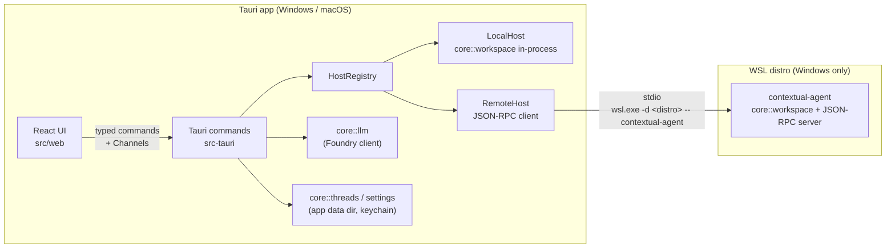

# Cross-platform Rust port

| | |
| --- | --- |
| **Status** | Proposed — not started |
| **Owner** | Tobias Legenden |
| **Date** | 2026-11-06 |
| **Scope** | Replace the Node "backend" (`src/server/`, mounted inside Vite) with a Rust core in a Tauri v2 desktop app for **Windows and macOS**. The Windows app can also open projects that live inside WSL. The React UI (`src/web/`) stays. |

## 1. Summary

Contextual today only runs as long as `vite` runs: the `/api` routes are a Vite plugin
(`src/server/plugin.ts`), so the app is tied to a dev server, reloads itself when it saves into
its own repo, and is guarded against other websites by a same-origin check instead of by
construction.

We will:

1. Move all server logic into a **Rust library (`contextual-core`)** with no UI or transport
   dependencies.
2. Ship it in a **Tauri v2 app** that hosts the existing React UI in the OS webview and exposes
   the core through typed Tauri commands — no HTTP server, no open port, no Node at runtime.
3. Put every project-file operation behind a **`WorkspaceHost`** interface with two
   implementations: *Local* (in-process) and *Remote* (JSON-RPC over stdio to a small
   `contextual-agent` process). On Windows, the Remote host runs the agent inside WSL, the
   same model VS Code's Remote-WSL uses.

**Targets:** the desktop app is built for **Windows and macOS only**. Linux code exists only as
the headless `contextual-agent`, which the Windows app deploys into a WSL distro. There is no
Linux desktop build.

The port is incremental (strangler pattern): during `tauri dev` the UI is served by Vite, so
routes that are not yet ported keep working through the old middleware until each slice reaches
parity. The Node version stays usable until the Windows app can open WSL projects, so today's
WSL workflow never regresses.

## 2. Context

- **UI:** React 19 + TypeScript + Vite 8 + Tailwind v4, ~8,300 lines. All backend calls go through
  `src/web/lib/api.ts` (312 lines): `fetch('/api/…')` with JSON bodies; chat is NDJSON streamed
  over the response body and cancelled with an `AbortSignal`.
- **Server:** ~2,300 lines across 12 files (`src/server/README.md` is the route reference):
  config + health, Foundry chat (Responses API with `previous_response_id`, fallback to chat
  completions, chain reset), edit repair, folder browsing, project scan (exclusions,
  `.gitignore`, token estimates, skill discovery, HTML/SVG condensing), file read, apply/undo
  with line-ending/BOM preservation and optimistic checks, saved threads, git (status, stage,
  diff, commit, push, branches) and PRs via `gh`.
- **Platform assumptions baked in today:** the server assumes it runs inside WSL/Linux/macOS —
  `fs/paths.ts` translates `C:\…` → `/mnt/c/…` and `\\wsl$\…` → `/…`; `fs/browse.ts` lists
  `/mnt/<x>` as drives; `threads.ts` and `fs/files.ts` use `$XDG_CACHE_HOME` / `~/.cache`.
- **Client state:** settings and recents in `localStorage`, the open folder in
  `sessionStorage`, `#open=<path>` deep link. Secrets in `.env.local`, read by the Vite plugin.
- **Tests:** none today. This is the biggest risk for a rewrite; see §10.

## 3. Goals

- G1. Run as a native desktop app on **Windows 10/11 and macOS (Apple Silicon + Intel)**.
- G2. Open projects that live **inside WSL from the Windows app**, with native-speed file and git
  access and the user's WSL git config and `gh` login. Local Windows projects (`C:\…`) are
  handled natively by the Windows app, not through WSL.
- G3. **No standalone backend service**: no listening port, nothing left running after the app
  closes. Helper processes are started on demand and owned by the app.
- G4. **Behavioural parity** with the current server for every route in `src/server/README.md`.
- G5. Keep the React UI and design system; UI changes are limited to the transport layer and the
  few platform-dependent screens (folder picker, settings for credentials, location badge).
- G6. Keep the safety model: the model never writes to disk; saving is explicit, checked against
  what the model saw, atomic and undoable.

## 4. Non-goals

- A Linux desktop build, including running the app inside WSL through WSLg.
- Rewriting the UI in a Rust UI framework (Leptos, Dioxus, egui).
- Remote hosts other than WSL (SSH, dev containers). The design must *allow* them; we don't build
  them now.
- Auto-update, code signing / notarization and installers for distribution. This is a
  local-only tool; unsigned local builds are acceptable. Revisit if it is shared.
- Replacing the `git` / `gh` CLIs with `git2` or `gix`. Shelling out keeps behaviour identical
  to what users see in their terminal and reuses their credentials.
- A browser-only mode. Once the port is complete, the app runs only inside Tauri.

## 5. Decision and alternatives

**Decision:** Tauri v2 + React UI + Rust core, with a stdio agent for WSL.

| Option | Verdict | Why |
| --- | --- | --- |
| **Tauri v2, keep React** | ✅ Chosen | Small rewrite (server only), native webviews on Windows and macOS, typed IPC, capability-based permissions, small binaries. |
| Rust UI framework (Leptos/Dioxus/egui) | ❌ | Rewrites ~8,300 lines of UI for no user-facing gain; egui also discards the design system. |
| Single Rust binary (axum) serving the built UI + opening a browser | ❌ | Smallest change, but it is still a local HTTP server: open port, same-origin defences, lifecycle tied to a browser tab. Exactly what we are moving away from. |
| Electron | ❌ | Same UI story as Tauri but bundles Chromium + Node; keeps a JS backend, which is the thing we want to drop. |
| Windows app accessing WSL files via `\\wsl.localhost\…` | ❌ | 9P file access is slow; Windows git on a Linux repo produces filemode/line-ending noise and ignores WSL git config and `gh` auth. |
| Linux build inside WSL shown through WSLg | ❌ | Out of scope (Windows and macOS only). The window also feels foreign (HiDPI, clipboard, fonts, drag-and-drop) and `/mnt/c` is slow. |

## 6. Architecture



### 6.1 Repository layout

```
Cargo.toml                 # workspace
crates/
  core/                    # contextual-core: no Tauri, no transport
    src/workspace/         # paths, browse, scan, condense, read, apply, undo, git, pr
    src/llm/               # config, Foundry (Responses + chat completions), repair, drafts
    src/threads.rs
    src/process.rs         # CommandRunner (PATH, no console window, timeouts)
    src/platform.rs        # dirs, hidden-file rules, drive/volume listing
  protocol/                # serde types shared by app, agent and (generated) TypeScript
  agent/                   # contextual-agent binary (Linux only): stdio JSON-RPC loop around core::workspace
src-tauri/                 # the Tauri app (Windows, macOS): commands, HostRegistry, capabilities, bundling
src/web/                   # React UI (unchanged apart from lib/api.ts and a few screens)
src/server/                # deleted in Phase 5
```

### 6.2 Where each concern runs

The split follows one rule: **anything that touches project files or project tools runs on the
host where the project lives; anything that does not stays in the app.**

| Concern | Runs in | Notes |
| --- | --- | --- |
| Browse, scan, read, condense | Workspace host | |
| Apply, undo, undo snapshots | Workspace host | Snapshots live next to the files' OS (`<cache>/contextual/undo/…` on that host). |
| git, branches, PR (`gh`) | Workspace host | Uses that host's git config and `gh` auth. |
| Foundry calls (chat, test, repair) | App | Needs network + key, not files. |
| Commit message / PR drafts | App, orchestrating | App asks the host for the diff/commits, then calls the model. |
| Threads (saved chats) | App | Keyed by `(location, root)`. |
| Settings, API key | App | Settings file in the config dir; key in the OS keychain. |

### 6.3 Core interfaces (sketch)

```rust
/// Where a project lives. Serialised into every workspace request and into thread keys.
/// `Wsl` only exists in Windows builds; macOS only ever uses `Local`.
pub enum Location { Local, Wsl { distro: String } }

#[async_trait]
pub trait WorkspaceHost: Send + Sync {
    async fn list_dirs(&self, req: ListDirs) -> Result<DirListing>;
    async fn scan(&self, req: Scan) -> Result<ScanResult>;
    async fn read(&self, req: ReadFiles) -> Result<Vec<FileContent>>;
    async fn apply(&self, req: Apply) -> Result<ApplyResult>;
    async fn undo(&self, req: Undo) -> Result<()>;
    async fn git(&self, req: GitRequest) -> Result<GitResponse>;   // status, stage, diff, commit, push, branches…
    async fn pr(&self, req: PrRequest) -> Result<PrResponse>;      // compare, create
}
```

- `LocalHost` calls `core::workspace` directly. `RemoteHost` serialises the same request types
  over JSON-RPC. Both are tested against the same suite (§10).
- Request/response types live in `crates/protocol` and are the single source of truth: TypeScript
  bindings are generated from them with `specta` / `tauri-specta`, replacing the hand-written
  interfaces in `lib/api.ts`. A CI check fails if the generated file is stale.
- Errors are a typed enum (`thiserror`) with a stable `code` + human message, mapped to the
  UI's current error display. Path errors keep the current 400-style semantics.

### 6.4 UI ↔ app transport

- Every route becomes a Tauri command, e.g. `project_scan`, `git_status`.
- **Streaming chat:** `chat_start(request, channel: Channel<ChatEvent>) -> RequestId`. The
  existing `ChatEvent` union (`delta`, `usage`, `done`, `error`) is sent over the channel
  unchanged, so `AppProvider` logic doesn't change.
- **Cancellation:** `chat_cancel(RequestId)` triggers a `CancellationToken`; `lib/api.ts` wires
  the existing `AbortSignal` to it. Dropping the stream must also abort the HTTP request.
- `lib/api.ts` keeps its exported function signatures; only their bodies change. During the
  migration it holds a small `Transport` switch (§9, Phase 0).

### 6.5 App ↔ agent protocol (WSL)

- **JSON-RPC 2.0**, newline-delimited over the agent's stdin/stdout; stderr carries `tracing`
  logs, which the app forwards to its log.
- **Handshake:** first call is `initialize { protocolVersion, appVersion }` →
  `{ agentVersion, capabilities }`. Mismatch → the app redeploys the matching agent.
- **Cancellation:** `$/cancel { id }` notification. **Progress** (long scans): notifications.
- **Deployment:** the Windows build bundles a static Linux agent (`x86_64-unknown-linux-musl`,
  plus `aarch64` if needed). On first connect to a distro the app copies it to
  `~/.cache/contextual/agent/<version>/contextual-agent` in that distro (via
  `wsl.exe -d <distro> -- sh -c 'mkdir -p … && cat > … && chmod +x …'` fed from stdin), then
  launches it. Old versions are pruned.
- **Lifecycle:** one agent per distro, started lazily, restarted with backoff if it dies, killed
  when the app exits (job object on Windows so it can't outlive the app).
- **Distro discovery:** read the registry, not `wsl.exe` output. Installed distros are the
  subkeys of `HKCU\Software\Microsoft\Windows\CurrentVersion\Lxss` (`DistributionName`), and
  `DefaultDistribution` holds the default one's GUID. This needs no process and has no
  encoding issues.
  - **Fallback:** `wsl.exe --list --quiet`. Its output encoding is **not fixed**: UTF-16LE by
    default, UTF-8 when `WSL_UTF8=1`, and UTF-8 was observed on the development machine with
    `WSL_UTF8` unset. Detect it per call (UTF-16LE if the bytes contain NULs or start with
    `FF FE`, otherwise UTF-8) and cover both cases with tests.
  - Treat other `wsl.exe` output (errors, `--status`) the same way.
- **Location detection (Windows app):** this replaces today's path translation in
  `fs/paths.ts`, which assumed the server runs inside WSL.
  - `C:\src\x` → `Location::Local` + `C:\src\x` (opened natively, not through WSL).
  - `\\wsl.localhost\Ubuntu\home\me\x` or `\\wsl$\Ubuntu\…` → `Location::Wsl { distro: "Ubuntu" }`
    + `/home/me/x`.
  - A POSIX path such as `/home/me/x` or `~/x` → the default WSL distro, when WSL is installed.
  - `/mnt/c/src/x` → `Location::Local` + `C:\src\x`, since the files are on the Windows side
    and native access is faster than going through the agent.
- **macOS** only accepts native paths (`/Users/…`, `~`); the Windows/WSL translations are
  compiled out.

## 7. Platform matrix

The desktop app has two targets. The third column is the headless agent the Windows app runs
inside WSL; it has no UI.

| Concern | Windows app | macOS app | WSL agent (Linux, headless) |
| --- | --- | --- | --- |
| Webview | WebView2 (preinstalled on 10/11; bundle the bootstrapper) | WKWebView | None |
| Paths | `PathBuf` + `dunce::canonicalize` (avoid `\\?\` prefixes); long paths | Case-insensitive APFS by default | Case-sensitive |
| Containment check (`resolveInside[Real]`) | Compare canonicalised paths; case-insensitive | Compare canonicalised paths; case-insensitive | As today |
| Hidden files | `FILE_ATTRIBUTE_HIDDEN` **or** leading `.` | Leading `.` (+ `UF_HIDDEN` optional) | Leading `.` |
| Spawning git/gh | `CREATE_NO_WINDOW` (also for `wsl.exe`); resolve `git.exe`/`gh.exe` | **GUI apps don't inherit the shell `PATH`** — resolve once via `$SHELL -ilc 'printf %s "$PATH"'` and fall back to `/opt/homebrew/bin:/usr/local/bin` | Started via `wsl.exe`, so it gets a non-interactive environment — resolve `PATH` from the login shell the same way as macOS |
| Git env | `GIT_TERMINAL_PROMPT=0`, `GCM_INTERACTIVE=never` | `GIT_TERMINAL_PROMPT=0` | `GIT_TERMINAL_PROMPT=0` |
| Writing files | Temp file + atomic replace, retry on sharing violations (editors/AV hold files) | Temp + rename | Temp + rename |
| Folder picker | Native dialog (`tauri-plugin-dialog`) for local; custom browser for WSL | Native dialog | Serves the custom browser's listings for WSL folders |
| "Places" in browser | Home, drives (`GetLogicalDrives`), one entry per WSL distro | Home, `/Volumes/*` | Home and `/` of that distro (`/mnt/<x>` is hidden: those are opened locally) |
| Data dirs (`directories` crate) | `%APPDATA%`, `%LOCALAPPDATA%` | `~/Library/Application Support`, `~/Library/Caches` | XDG (agent binary, undo snapshots) |
| API key | Credential Manager (`keyring`) | Keychain | Never sent to the agent |
| Build | `windows-latest` runner; bundles the musl agent built on `ubuntu-latest` | `macos-latest` runner, universal binary, ad-hoc signed | `ubuntu-latest` runner, static musl, x86_64 (+ aarch64) |

Line endings, BOM and final-newline preservation on save must behave identically on every
target (it is byte-level logic, so this is a test requirement, not a platform branch).

Because the macOS app uses WKWebView (Safari's engine) and the Windows app uses WebView2
(Chromium), the UI runs on two browser engines; both must be checked for CSS and JS
differences.

## 8. Data, configuration and security

### 8.1 Storage and migration

| Data | Today | After | Migration |
| --- | --- | --- | --- |
| Foundry config | `.env.local` in the repo | `settings.json` in the config dir; edited in Settings | On first run, offer to import from a `.env.local` path. Env vars still override (useful for dev). |
| API key | `.env.local` | OS keychain | Imported with the config; never written to `settings.json`. |
| Threads | `~/.cache/contextual/threads/` (inside WSL today) | App **data** dir (chats aren't a cache) | On first run, the Windows app offers to import from `\\wsl.localhost\<distro>\home\<user>\.cache\contextual\threads`, re-keying WSL projects to `Location::Wsl` and `/mnt/<x>` projects to local Windows paths; the original is left in place. |
| Undo snapshots | `~/.cache/contextual/undo/` | Cache dir on the workspace host | None needed (short-lived). |
| UI settings, recents | `localStorage` | Tauri store plugin (file in config dir) | Webview origin changes, so old `localStorage` is not readable; one-time import is not possible automatically — document it. |
| Open folder on reload | `sessionStorage` | Keep (reloads still happen in dev) | — |
| `#open=<path>` | URL hash | CLI argument (`contextual <path>`) and `contextual://open?path=` deep link | Keep the hash for dev. |

### 8.2 Security model

- **No network listener.** The same-origin and `Content-Type` checks in `api.ts` become
  unnecessary and are removed; Tauri IPC is only reachable from the app's own webview.
- **Capabilities:** allow only the app's own commands plus `dialog` and `store`. No `shell`,
  `fs` or `http` plugin permissions for the webview — all file and process access goes through
  core functions that validate inputs.
- **CSP:** `default-src 'self'`; `img-src 'self' data: blob:` (pasted images); no remote
  scripts. The webview never talks to Azure directly; the key never reaches JS.
- **Path containment** stays in the core (`resolve_inside`, symlink-aware variant) and is
  enforced on the workspace host, so the agent is as safe as the local host.
- **Root allowlist:** the app records roots the user opened (dialog, recents, CLI). Workspace
  commands reject a `root` that isn't in that set. This closes the "UI passes any root" gap.
- **Process execution:** fixed argument vectors, never a shell; inherited env filtered.
- **Endpoint validation** (HTTPS, or `http://localhost` for mocks) is ported as-is.

## 9. Delivery plan

Each phase ends with a working app. Phases 1–4 are vertical slices; the old Node routes keep
serving anything not yet ported, because `tauri dev` loads the UI from the Vite dev server.

WSL support (Phase 4) comes **before** Node is removed (Phase 5). Today the app runs inside WSL,
so removing Node first would leave the main current workflow unsupported until the agent
existed.

**Dev setup note:** `tauri dev` for the Windows app runs on Windows (Rust + Node on the Windows
side, repo checked out on Windows or opened over `\\wsl.localhost`). Until Phase 4 is done, the
Node routes then run on Windows too, so WSL projects are only usable through the old
`npm run dev` inside WSL during the port.

### Phase 0 — Prepare the TypeScript side

- Add a `Transport` seam in `lib/api.ts`: per-route choice between `fetch('/api/…')` and
  `invoke(…)`, defaulting to HTTP. No behaviour change.
- Write the **parity fixtures** (§10.2) against the current Node server: representative
  projects (CRLF/BOM files, `.gitignore`, skills, large HTML/SVG, images, symlinks) and the
  JSON each route returns for them.
- **Exit:** app unchanged; fixtures captured and checked in.

### Phase 1 — Tauri shell and workspace skeleton

- Cargo workspace, `crates/{core,protocol,agent}`, `src-tauri`; `tauri dev` points at Vite.
- `tauri-specta` binding generation wired into `npm run build` and CI.
- CI: `cargo fmt --check`, `cargo clippy -D warnings`, `cargo test`, `npm run lint`,
  `npm run build` on all jobs; `tauri build` on `windows-latest` and `macos-latest`; `core` +
  `agent` tests and the musl agent build on `ubuntu-latest`.
- Check the UI in both engines (WebView2 and WKWebView) early.
- **Exit:** the current UI runs inside a Tauri window on Windows and macOS, still using Node
  routes.

### Phase 2 — LLM slice

- `core::llm`: config validation, health, connection test, chat streaming over
  Responses API (`store: true`, `previous_response_id`), chain-reset retry, fallback to chat
  completions, usage incl. `cachedTokens`, cancellation; `edit/repair`.
- Settings screen gains endpoint/deployment fields and a key field (keychain).
- HTTP client: `reqwest` (rustls) + an SSE parser; no OpenAI SDK.
- **Exit:** chat, test and repair go through Rust on Windows and macOS; parity tests pass against
  a mock Foundry server.

### Phase 3 — Workspace slice (local host)

- `core::workspace`: paths, browse, scan (`ignore` + `globset`), condense, read, apply, undo;
  threads in the app.
- `LocalHost` + `HostRegistry` (only `Location::Local` for now) and the root allowlist.
- Native folder picker for local projects; custom browser kept for typed paths.
- Then git, branches and PR (`CommandRunner` with the per-OS rules in §7).
- **Exit:** every route runs through Rust for local projects; parity suite green on Windows,
  macOS and Linux CI (the core is also what the agent runs).

### Phase 4 — WSL remote host (Windows app)

- `contextual-agent` (JSON-RPC server around `core::workspace`), musl builds, bundled into the
  Windows app only.
- `RemoteHost`, agent deployment and lifecycle, distro discovery, location detection (§6.5).
- UI (Windows only): location badge in the status bar (*Local* / *WSL: Ubuntu*), WSL distros
  under "Places", threads keyed by location. On macOS these elements are not rendered.
- **Exit:** from the Windows app, open a project in `\\wsl.localhost\Ubuntu\…`, scan, chat,
  save, undo, commit and open a PR, with timings comparable to today's app running inside WSL.
  The shared host test suite passes against `RemoteHost`.

### Phase 5 — Remove Node, ship builds

- Delete `src/server/`, the Vite plugin, `openai`, `ignore` and `picomatch` dependencies and
  the `Transport` switch.
- Data migration (§8.1), CLI argument and deep link, app icons, release builds for Windows and
  macOS.
- Update `CLAUDE.md` and replace `src/server/README.md` with a command reference.
- **Exit:** `npm run dev` no longer serves `/api`; release builds run on Windows (local and WSL
  projects) and macOS.

### Phase 6 — Hardening

- Performance pass: scan of a large repo (including skill discovery's 20,000-entry cap) on
  Windows, macOS and over the agent.
- Failure drills: agent crash mid-save, distro shut down, WSL not installed, `gh` logged out,
  git missing, keychain unavailable, file locked on Windows.
- Accessibility check of the changed screens (`web-design-guidelines` skill).

## 10. Testing strategy

There are no tests today, so the port must create the safety net it relies on.

1. **Unit tests in `core`** for the pure logic most likely to regress: path normalisation and
   containment (including Windows and case-insensitive cases), exclusion rules, token
   estimates, condensing, line-ending/BOM/final-newline preservation, apply pre-checks.
2. **Parity tests:** the Phase 0 fixtures are replayed against the Rust implementation and
   compared field by field (with explicit, documented allowances, e.g. `mtimeMs`). This is
   the definition of "done" for each slice.
3. **Host contract suite:** one generic test suite run against `LocalHost` and `RemoteHost`
   (agent spawned as a child process locally on Linux CI), so the two can't drift.
4. **Git integration tests** in temporary repos: status letters, stage/unstage, staged vs
   working diffs, smart commit, branch create with recorded parent, compare/merge-base. `gh`
   calls are behind the `CommandRunner` and faked in tests.
5. **LLM tests** against a local mock server (`wiremock`): streaming deltas, usage, chain
   reset, Responses → chat-completions fallback, cancellation mid-stream, error mapping.
6. **Manual smoke checklist** per release on Windows and macOS (open, scan, chat, save, undo,
   commit, PR), plus the same list for a WSL project from the Windows app.

## 11. Risks and mitigations

| Risk | Impact | Mitigation |
| --- | --- | --- |
| Behaviour drift during the rewrite (no existing tests) | High | Phase 0 fixtures + parity tests gate each slice; port module by module, not all at once. |
| Webview differences (WKWebView on macOS vs WebView2 on Windows) for CSS/JS features | Medium | Test the UI on both in Phase 1; avoid Chromium-only APIs. |
| WSL project unusable while the Windows app is being built | Medium | Keep the Node version runnable inside WSL until Phase 4 is done; Node is removed only in Phase 5. |
| No Mac for day-to-day development (testing happens later on a friend's Mac) | Low | `macos-latest` CI runner builds and tests every change; run the manual smoke checklist on the Mac at the end of Phase 1 (UI in WKWebView) and before each release. |
| Agent deployment fails (no `/tmp` space, noexec mounts, arm64 distro) | Medium | Deploy to `~/.cache`; static musl builds for x86_64 and aarch64; clear error with a manual install command. |
| macOS GUI `PATH` misses Homebrew git/gh | Medium | PATH resolution in `CommandRunner` (§7) and a "git/gh not found" diagnostic in Settings. |
| Windows file locks break atomic save | Medium | Retry with backoff; pre-checks stay before any write so a partial save is impossible. |
| Losing `localStorage` settings on switch | Low | Documented; settings are few and re-entered once. |
| Responses API differences between SDK and hand-rolled client | Medium | Mock-server tests from recorded real responses (key redacted). |

## 12. Open questions

1. Which WSL distros/architectures must the agent support at first — only the default
   x86_64 distro, or all installed ones?
2. Should a POSIX path typed into the Windows app (`/home/me/x`) default to the default WSL
   distro, or should the user always pick the distro?
3. Keep the custom folder browser at all for local projects once the native dialog exists?
4. Is an import of the old `localStorage` settings worth a small export button in the last
   Node-based version?
5. Do we want a `contextual` CLI shim on `PATH` (like `code .`) in Phase 5 or later?

## 13. Decision log

| Date | Decision |
| --- | --- |
| 2026-11-06 | Port the server to Rust inside Tauri v2; keep the React UI. |
| 2026-11-06 | WSL projects are served by a stdio agent inside the distro, not via `\\wsl.localhost` file access. |
| 2026-11-06 | Keep shelling out to `git` and `gh`; no libgit2/gix. |
| 2026-11-06 | Desktop targets are Windows and macOS only; no Linux desktop build. WSL projects are a Windows-app feature. |
| 2026-11-06 | WSL support lands before Node is removed, so today's WSL workflow never regresses. |
